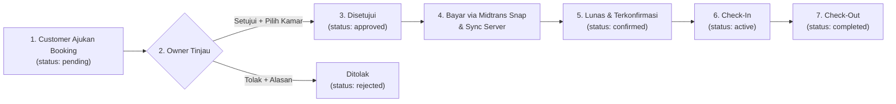
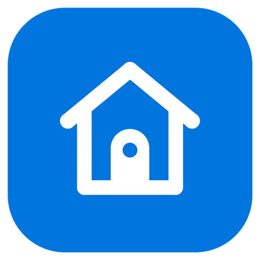

<div align="center">


<h3>Platform Pencarian, Pemesanan & Pengelolaan Rumah Kos Cross-Platform</h3>

[](https://flutter.dev)
[](https://dart.dev)
[](https://riverpod.dev)
[](https://laravel.com)
[](https://midtrans.com)
[](https://www.openstreetmap.org)

<p>
  <a href="#fitur-utama">Fitur Utama</a> •
  <a href="#alur-owner-approval-first">Alur Booking</a> •
  <a href="#tech-stack--arsitektur">Tech Stack</a> •
  <a href="#cara-menjalankan-local-dev">Cara Menjalankan</a> •
  <a href="#dokumentasi">Dokumentasi</a>
</p>


</div>

---

## Tentang TEMPATIN MOBILE

**TEMPATIN MOBILE** adalah aplikasi mobile native cross-platform (**Android & iOS**) berbasis **Flutter** yang terhubung dengan backend **Laravel 12 + Sanctum REST API (`/api/v1`)**.  
Dirancang dengan sistem visual *Notion Warm Paper Hybrid* (`#0075DE` Primary, `#F6F5F4` Paper Canvas, tipografi **Inter** & **Source Serif 4**), aplikasi ini menghadirkan pengalaman native yang lengkap untuk **Pencari Kos (Customer)** dan **Pemilik Kos (Owner)**.

---

## Fitur Utama

<table>
  <tr>
    <td width="50%" valign="top">
      <h3>Untuk Pencari Kos (Customer & Guest)</h3>
      <ul>
        <li><b>Beranda & Eksplorasi</b>: Pencarian kata kunci, filter kota, tipe (Putra/Putri/Campur/Eksklusif), rentang harga, fasilitas, dan urutkan.</li>
        <li><b>Detail Properti</b>: Galeri foto layar penuh, spesifikasi kamar tersedia, peta lokasi <b>OpenStreetMap</b> + Google Maps launcher, dan ulasan terverifikasi.</li>
        <li><b>Booking (Owner Approval First)</b>: Pilih kamar, durasi (1–12 bulan), rincian biaya transparan, dan pembatalan selama status <code>pending</code>.</li>
        <li><b>Pembayaran Midtrans Snap</b>: WebView checkout dalam aplikasi + sinkronisasi status server-side yang aman & idempotent.</li>
        <li><b>Dokumen & Layanan</b>: Nota pembayaran PDF, Kontrak Sewa Digital (tanda tangan elektronik + PDF), jadwal survei lokasi, laporan kerusakan (dengan upload foto), dan chat langsung dengan pemilik.</li>
      </ul>
    </td>
    <td width="50%" valign="top">
      <h3>Untuk Pemilik Kos (Owner)</h3>
      <ul>
        <li><b>Dashboard Real-Time</b>: Ringkasan total properti, kos aktif, rata-rata harga, serta antrean booking, survei, dan laporan kerusakan.</li>
        <li><b>Manajemen Properti & Kamar</b>: CRUD kos (multi-foto, pilih fasilitas, pin lokasi peta OSM + pencarian alamat Nominatim) dan inventaris kamar individual.</li>
        <li><b>Persetujuan Booking & Hunian</b>: Alokasi kamar saat <i>Approve</i>, <i>Reject</i> dengan alasan, serta proses <i>Check-In</i> & <i>Check-Out</i> penghuni.</li>
        <li><b>Operasional & Komunikasi</b>: Kelola jadwal survei, tindak lanjut laporan kerusakan, balas ulasan penghuni, dan chat internal.</li>
        <li><b>Statistik Pendapatan</b>: Grafik tren pendapatan 6 bulan terakhir (<code>fl_chart</code>), tingkat okupansi, dan performa per properti.</li>
      </ul>
    </td>
  </tr>
</table>

---

## Alur *Owner Approval First*



---

## Tech Stack & Arsitektur

| Lapisan | Teknologi |
| :--- | :--- |
| **Framework & Bahasa** | Flutter `3.50.0` • Dart `^3.14.0` |
| **State Management** | `flutter_riverpod` (`^3.5.0`) |
| **Navigasi** | `go_router` (`^18.1.4`) dengan `StatefulShellRoute` & Role Guard |
| **Networking & Model** | `dio` (`^5.11.1`) • `freezed` • `json_serializable` |
| **Penyimpanan Aman** | `flutter_secure_storage` (Sanctum Token) • `shared_preferences` |
| **Peta, Pembayaran & PDF** | `flutter_map` + `latlong2` • `webview_flutter` • `printing` • `share_plus` |
| **UI, Grafik & Media** | `google_fonts` • `lucide_icons_flutter` • `fl_chart` • `image_picker` |
| **Backend Terintegrasi** | Laravel 12 • Laravel Sanctum (`/api/v1`) • MySQL / SQLite |

---

## Cara Menjalankan (Local Dev — Physical Android Device)

Pastikan HP Android terhubung via USB dengan **USB Debugging** aktif.

### 1. Jalankan Backend Laravel (Terminal 1)
```powershell
cd "C:\Users\Thinkpad\Downloads\TEMPATIN"
php artisan serve --host=127.0.0.1 --port=8000
```

### 2. Jalankan Flutter dengan Hot Reload (Terminal 2)
```powershell
cd "C:\Users\Thinkpad\Downloads\TEMPATIN MOBILE"
flutter pub get
adb reverse tcp:8000 tcp:8000
flutter run
```
> Tekan **`r`** untuk *Hot Reload*, **`R`** untuk *Hot Restart*, atau **`q`** untuk berhenti.

### 3. Build Release Android
```powershell
flutter build apk --release
flutter build appbundle --release
```

<details>
<summary><b>Akun Uji Default (Seeder Backend)</b></summary>

| Role | Email | Password |
| :--- | :--- | :--- |
| **Customer** | `dewi@email.com` | `password123` |
| **Owner** | `owner@tempatin.id` | `password123` |

</details>

---

## Hasil Verifikasi QA Terakhir

- **`flutter analyze`**: `0 issues found`
- **`flutter test`**: `21 / 21 passed` (`widget_test`, `phase5_customer_test`, `phase7_transaction_test`, `phase8_9_owner_chat_test`)
- **Backend Laravel (`php artisan test`)**: `261 passed (934 assertions)`

---

## Dokumentasi

- [PROJECT_CONTEXT.md](PROJECT_CONTEXT.md) — Ringkasan arsitektur, alur bisnis, struktur folder, dan progres fase.
- [docs/API_CONTRACT.md](docs/API_CONTRACT.md) — Spesifikasi endpoint REST `/api/v1`.
- [docs/MOBILE_ARCHITECTURE.md](docs/MOBILE_ARCHITECTURE.md) — Arsitektur feature-first Flutter & Riverpod.
- [docs/DESIGN_SYSTEM.md](docs/DESIGN_SYSTEM.md) — Token warna, tipografi, dan komponen UI.
- [docs/DEPLOYMENT_AND_QA_CHECKLIST.md](docs/DEPLOYMENT_AND_QA_CHECKLIST.md) — Panduan release signing, `--dart-define`, dan checklist QA.

<div align="center">
  <br />
  
  <br />
  <sub>Built with Flutter & Laravel 12 — TEMPATIN Ecosystem</sub>
</div>
