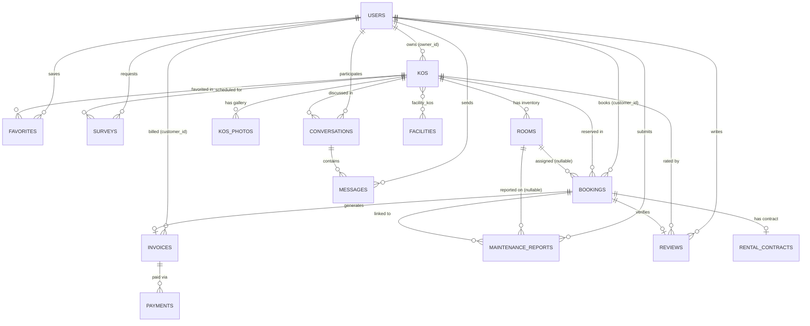

# TEMPATIN MOBILE — Database Schema & Eloquent Model Reference

> Verified directly from all 26 migrations in `C:\Users\Thinkpad\Downloads\TEMPATIN\database\migrations\` and all 15 models in `app\Models\`.
> **Rule**: Flutter NEVER connects to MySQL/SQLite directly. This document serves as the canonical backend domain reference for API design and DTO modeling.

---

## 1. Entity Relationship Diagram (Core Business Domain)

---

## 2. Complete Table Reference (21 Effective Tables)

### 2.1 `users`
| Column | Type | Constraints / Default | Notes |
| :--- | :--- | :--- | :--- |
| `id` | `bigint unsigned` | PK | |
| `name` | `varchar(255)` | NOT NULL | |
| `email` | `varchar(255)` | NOT NULL, UNIQUE | |
| `google_id` | `varchar(255)` | NULLABLE, UNIQUE (MySQL) | *Non-unique on SQLite after migration `2026_10_18_000002`* |
| `phone` | `varchar(30)` | NULLABLE | |
| `avatar` | `varchar(255)` | NULLABLE | Stored on `public` disk as `avatars/...` |
| `password` | `varchar(255)` | NOT NULL | Cast: `hashed` |
| `role` | `varchar(30)` | NOT NULL, DEFAULT `'customer'`, INDEX | Values: `customer`, `owner`, `admin` |
| `email_verified_at` | `timestamp` | NULLABLE | |
| `remember_token` | `varchar(100)` | NULLABLE | |
| `created_at`, `updated_at` | `timestamp` | NULLABLE | |

### 2.2 `kos` *(SoftDeletes: `deleted_at`)*
| Column | Type | Constraints / Default | Notes |
| :--- | :--- | :--- | :--- |
| `id` | `bigint unsigned` | PK | |
| `owner_id` | `bigint unsigned` | FK -> `users.id` (`RESTRICT`) | |
| `title` | `varchar(255)` | NOT NULL | |
| `slug` | `varchar(255)` | NOT NULL, UNIQUE | Auto-generated from title |
| `description` | `text` | NULLABLE | |
| `price` | `decimal(12,2)` | NOT NULL | Base monthly price (IDR) |
| `type` | `enum` | NOT NULL, DEFAULT `'Campur'` | `'Putra'`, `'Putri'`, `'Campur'`, `'Eksklusif'` |
| `city` | `varchar(100)` | NOT NULL | Composite index `['city','type','price','status']` |
| `address` | `text` | NULLABLE | |
| `latitude` | `decimal(10,8)` | NULLABLE | Cast: `float` |
| `longitude` | `decimal(11,8)` | NULLABLE | Cast: `float` |
| `area` | `varchar(50)` | NULLABLE | e.g., `"3x4 m"` |
| `rooms` | `varchar(50)` | NULLABLE | **Warning**: collides with `Kos::rooms()` relation |
| `bathrooms`, `bedrooms`, `garages` | `varchar(50)` | NULLABLE | Summary strings |
| `thumbnail` | `varchar(255)` | NULLABLE | Dual format: `storage/kos/...` or `assets/img/kos/1.png` |
| `status` | `enum` | NOT NULL, DEFAULT `'active'` | `'active'`, `'inactive'` |
| `deleted_at`, `created_at`, `updated_at` | `timestamp` | NULLABLE | SoftDeletes enabled |

### 2.3 `facilities` & `facility_kos`
- `facilities`: `id` PK, `name` (`varchar(255)`), `slug` (`varchar(255)` UNIQUE), timestamps.
- `facility_kos`: `id` PK, `kos_id` FK (`CASCADE`), `facility_id` FK (`CASCADE`), UNIQUE(`kos_id`, `facility_id`), timestamps.
- **Seeded 13 Facilities**: `WiFi`, `AC`, `Kamar Mandi Dalam`, `Kasur`, `Lemari`, `Meja`, `Kursi`, `Parkir Motor`, `Parkir Mobil`, `Dapur`, `CCTV`, `Laundry`, `Listrik`.

### 2.4 `kos_photos`
- `id` PK, `kos_id` FK -> `kos.id` (`CASCADE`), `photo_path` (`varchar(255)`, stored as `kos/photos/...`), `sort_order` (`int unsigned`, default `0`), timestamps.
- UNIQUE(`kos_id`, `photo_path`), INDEX(`kos_id`, `sort_order`).

### 2.5 `rooms`
- `id` PK, `kos_id` FK -> `kos.id` (`CASCADE`), `room_number` (`varchar(50)`), `floor` (`varchar(20)` nullable), `room_type` (`varchar(50)` nullable), `price_override` (`decimal(12,2)` nullable), `status` (`varchar(30)`, default `'available'`: `available`, `occupied`, `maintenance`), `notes` (`text` nullable), timestamps.
- UNIQUE(`kos_id`, `room_number`), INDEX(`kos_id`, `status`).

### 2.6 `bookings`
- `id` PK, `customer_id` FK (`RESTRICT`), `kos_id` FK (`RESTRICT`), `room_id` FK (`SET NULL` on MySQL; *no FK on SQLite after migration `2026_10_18_000002`*).
- `booking_code` (`varchar(50)` UNIQUE, format `BKG-YYYYMM-XXXXX`).
- `tenant_name` (`varchar(100)`), `tenant_phone` (`varchar(30)`), `tenant_email` (`varchar(150)`).
- `start_date` (`date`), `end_date` (`date`), `duration_months` (`tinyint unsigned`, default `1`).
- `kos_price`, `subtotal`, `admin_fee` (default `25000.00`), `total_amount` (all `decimal(12,2)`).
- `notes` (`text` nullable), `status` (`varchar(30)`, default `'pending'`: `pending`, `approved`, `confirmed`, `active`, `completed`, `cancelled`, `rejected`), `rejection_reason` (`text` nullable), timestamps.
- INDEX(`customer_id`, `status`), INDEX(`start_date`, `end_date`).

### 2.7 `invoices`
- `id` PK, `booking_id` FK (`RESTRICT`), `customer_id` FK (`RESTRICT`), `kos_id` FK (`RESTRICT`).
- `invoice_number` (`varchar(50)` UNIQUE, format `INV-YYYYMM-XXXX`).
- `amount`, `admin_fee` (default `25000.00`), `tax` (default `0.00`), `total_amount` (all `decimal(12,2)`).
- `due_date` (`date`), `paid_at` (`timestamp` nullable), `status` (`enum`: `unpaid`, `paid`, `expired`, `cancelled`, default `'unpaid'`), timestamps.
- INDEX(`customer_id`, `status`), INDEX(`kos_id`, `due_date`).

### 2.8 `payments`
- `id` PK, `invoice_id` FK (`RESTRICT`).
- `payment_code` (`varchar(50)` UNIQUE, format `PAY-YYYYMM-XXXXX`), `order_id` (`varchar(100)` nullable, INDEX, format `TPT-{code}-{ts}`).
- `payment_method` (`varchar(50)`, default `'virtual_account'`), `payment_channel` (`varchar(50)` nullable), `transaction_id` (`varchar(100)` nullable, UNIQUE).
- `amount` (`decimal(12,2)`), `snap_token` (`varchar(255)` nullable), `snap_redirect_url` (`text` nullable), `payment_proof` (`varchar(255)` nullable, unused in live flow).
- `status` (`enum`: `pending`, `success`, `failed`, `expired`, default `'pending'`), `paid_at` (`timestamp` nullable), `payload_response` (`json` nullable), timestamps.
- INDEX(`invoice_id`, `status`), INDEX(`order_id`).

### 2.9 `rental_contracts`
- `id` PK, `booking_id` FK (`CASCADE`).
- `contract_number` (`varchar(60)` UNIQUE, format `CTR-YYYYMM-XXXXX`).
- `terms` (`longText`), `signed_at` (`timestamp` nullable), `signer_ip` (`varchar(45)` nullable), `status` (`varchar(30)`, default `'draft'`: `draft`, `active`, `completed`), timestamps.
- INDEX(`booking_id`, `status`).

### 2.10 `surveys`
- `id` PK, `kos_id` FK (`CASCADE`), `customer_id` FK (`CASCADE`).
- `survey_date` (`date`), `survey_time` (`varchar(20)`), `notes` (`text` nullable), `status` (`varchar(30)`, default `'pending'`: `pending`, `approved`, `rejected`, `cancelled`, `completed`), `rejection_reason` (`text` nullable), timestamps.
- INDEX(`kos_id`, `status`), INDEX(`customer_id`, `status`), INDEX(`survey_date`, `survey_time`).

### 2.11 `maintenance_reports`
- `id` PK, `booking_id` FK (`CASCADE`), `customer_id` FK (`CASCADE`), `kos_id` FK (`CASCADE`), `room_id` FK (`SET NULL`, nullable).
- `title` (`varchar(150)`), `description` (`text`), `photo` (`varchar(255)` nullable, `maintenance/...`), `status` (`varchar(30)`, default `'open'`: `open`, `in_progress`, `resolved`, `rejected`), `owner_notes` (`text` nullable), timestamps.
- INDEX(`kos_id`, `status`), INDEX(`customer_id`, `status`), INDEX(`booking_id`, `status`).

### 2.12 `conversations` & `messages`
- `conversations`: `id` PK, `kos_id` FK (`CASCADE`), `customer_id` FK (`CASCADE`), `owner_id` FK (`CASCADE`), timestamps. UNIQUE(`kos_id`, `customer_id`, `owner_id`), INDEX(`customer_id`, `updated_at`), INDEX(`owner_id`, `updated_at`).
- `messages`: `id` PK, `conversation_id` FK (`CASCADE`), `sender_id` FK (`CASCADE`), `message` (`text`), `is_read` (`boolean`, default `false`), timestamps. INDEX(`conversation_id`, `created_at`), INDEX(`sender_id`, `is_read`).

### 2.13 `reviews`
- `id` PK, `kos_id` FK (`CASCADE`), `user_id` FK (`SET NULL`, nullable), `booking_id` FK (`SET NULL`, nullable).
- `reviewer_name` (`varchar(255)`), `is_verified_tenant` (`boolean`, default `false`), `rating` (`tinyint unsigned`, default `5`), `comment` (`text`), `reply` (`text` nullable), timestamps.

### 2.14 `favorites`, `notifications`, & System Tables
- `favorites`: `id` PK, `user_id` FK (`CASCADE`), `kos_id` FK (`CASCADE`), UNIQUE(`user_id`, `kos_id`), INDEX(`user_id`, `created_at`).
- `notifications`: `id` (`uuid` PK), `type`, `notifiable_type`, `notifiable_id`, `data` (`text` JSON), `read_at` (`timestamp` nullable), timestamps.
- System tables: `sessions`, `cache`, `cache_locks`, `password_reset_tokens`.
- **New Table Required in Phase 6 (Laravel Sanctum)**: `personal_access_tokens` (via `php artisan install:api`).

---

## 3. Domain Code Formats & Status Constants

| Entity | Code Generator | Format Example | Status Values |
| :--- | :--- | :--- | :--- |
| `Booking` | `Booking::generateBookingCode()` | `BKG-202611-A1B2C` | `pending`, `approved`, `confirmed`, `active`, `completed`, `cancelled`, `rejected` |
| `Invoice` | `Invoice::generateInvoiceNumber()` | `INV-202611-0001` | `unpaid`, `paid`, `expired`, `cancelled` |
| `Payment` | `Payment::generatePaymentCode()` | `PAY-202611-X9Y8Z` | `pending`, `success`, `failed`, `expired` |
| Midtrans Order | `MidtransService` | `TPT-BKG202611A1B2C-173...` | Mapped from Midtrans `transaction_status` |
| `RentalContract` | `RentalContract::generateContractNumber()` | `CTR-202611-K4M5N` | `draft`, `active`, `completed` |
| `Room` | Owner-defined `room_number` | `A-101` | `available`, `occupied`, `maintenance` |
| `Survey` | Numeric `id` | — | `pending`, `approved`, `rejected`, `cancelled`, `completed` |
| `MaintenanceReport` | Numeric `id` | — | `open`, `in_progress`, `resolved`, `rejected` |

---

## 4. Seeded Test Accounts (`DatabaseSeeder.php`)

| Role | Email | Password | Seeded Data |
| :--- | :--- | :--- | :--- |
| **Owner** | `owner@tempatin.id` | `password123` | 6 active kos listings across Surabaya, Malang, Yogyakarta, Bandung, Jakarta Selatan, Semarang |
| **Customer** | `dewi@email.com` | `password123` | 1 confirmed booking (`BKG-202608-0001`), 1 paid invoice (`INV-2026-08-0001`), 1 success payment, 1 verified review |
| **Admin** | *Not seeded* | — | Recommend adding an optional admin user in seeder for Phase 6 API testing |
