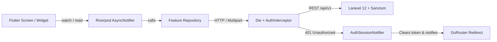

# TEMPATIN MOBILE — Flutter Application Architecture

> Feature-first, layered architecture built with **Flutter**, **Riverpod**, **GoRouter**, **Dio**, and **Freezed**.

---

## 1. Architectural Principles

1. **Feature-First Organization**: Every business vertical owns its `data/`, `domain/`, and `presentation/` layers so features scale independently and avoid cross-feature spaghetti.
2. **Pragmatic Clean Architecture**:
   - **Presentation**: Widgets, Screens, and Riverpod `AsyncNotifier` / `Notifier` controllers. Zero direct `Dio` calls in widgets.
   - **Domain**: Immutable `Freezed` entities/models, repository interfaces, and status enums. Avoid redundant one-line UseCase boilerplate unless a flow coordinates multiple repositories (e.g., Booking + Payment).
   - **Data**: Concrete repository implementations, remote data sources (Dio), local data sources (SecureStorage / SharedPreferences), and DTO-to-entity mapping.
3. **Unidirectional Data Flow**: UI dispatches actions to Riverpod Notifiers -> Repositories call Dio -> Typed `Result`/`AsyncValue` updates UI -> Loading, Empty, Error, and Data states handled uniformly.
4. **Role-Aware Isolation**: Customer and Owner shells share core discovery/chat/notification primitives while keeping Owner management screens and providers cleanly isolated under `features/owner/`.

---

## 2. Folder Structure (`lib/`)

```text
lib/
  app/
    app.dart                  # Root MaterialApp.router + Theme + Locale (id_ID)
    bootstrap.dart            # Environment init, Riverpod ProviderContainer, error hooks
    router/
      app_router.dart         # GoRouter config, auth & role redirect guards
      route_names.dart        # Typed route paths & names
      customer_shell.dart     # 5-tab StatefulShellRoute for Guest/Customer
      owner_shell.dart        # 5-tab StatefulShellRoute for Property Owner
    theme/
      app_colors.dart         # Design tokens (#0075DE, #F6F5F4, #FFFFFF, alpha ink)
      app_typography.dart     # Inter + Source Serif 4 mobile type scale
      app_spacing.dart        # 4dp grid & radii (4, 8, 12, 9999)
      app_theme.dart          # ThemeData (Material 3 tuned to flat hairline aesthetic)

  core/
    config/
      env.dart                # --dart-define env config (API_BASE_URL, ENV_NAME)
    constants/
      api_endpoints.dart      # Centralized /api/v1/... paths
      storage_keys.dart       # SecureStorage & SharedPreferences keys
    errors/
      app_exception.dart      # Typed exceptions (Network, Auth, Validation, Server)
      error_mapper.dart       # DioException -> user-friendly Indonesian messages
    network/
      dio_client.dart         # Dio instance + timeouts + logging (debug only)
      auth_interceptor.dart   # Injects Sanctum Bearer token + handles 401 expiry
      api_response.dart       # Generic ApiResponse<T> & PaginatedResponse<T>
    storage/
      secure_storage.dart     # FlutterSecureStorage wrapper (Sanctum token)
      prefs_storage.dart      # SharedPreferences wrapper (recent searches, onboarding)
    utils/
      currency_formatter.dart # Rp 850.000 formatting
      date_formatter.dart     # id_ID date formatting
      validators.dart         # Form field validators matching Laravel FormRequests
    widgets/
      tempatin_button.dart
      tempatin_card.dart
      tempatin_text_field.dart
      status_badge.dart
      app_empty_state.dart
      app_error_state.dart
      app_bottom_sheet.dart
      skeletons.dart

  features/
    authentication/           # Login, Register, Google Sign-In, Forgot/Reset Password
      data/
      domain/
      presentation/
    home/                     # Curated Home, popular cities, quick search
      data/
      domain/
      presentation/
    property/                 # Explore, Search/Filter, Kos Detail, Gallery, Map
      data/
      domain/
      presentation/
    favorites/                # Wishlist list & optimistic heart toggle
      data/
      domain/
      presentation/
    booking/                  # Room selection, Booking Form, Booking Detail, Cancel
      data/
      domain/
      presentation/
    payment/                  # Payment Summary, Midtrans Snap WebView, Status Sync
      data/
      domain/
      presentation/
    invoice/                  # Invoice List, Invoice Detail, Nota PDF Viewer/Download
      data/
      domain/
      presentation/
    contracts/                # Digital Rental Contract View, Sign, PDF Download
      data/
      domain/
      presentation/
    survey/                   # Schedule Survey, My Surveys, Cancel
      data/
      domain/
      presentation/
    maintenance/              # Maintenance Reports List, Create with Photo Upload
      data/
      domain/
      presentation/
    messaging/                # Conversation List, Chat Detail, Smart Polling
      data/
      domain/
      presentation/
    reviews/                  # Kos Reviews List, Verified Review Submission
      data/
      domain/
      presentation/
    notifications/            # Notification Feed, Unread Badge, Mark Read
      data/
      domain/
      presentation/
    profile/                  # Profile View, Edit Profile + Avatar Upload, About/Help
      data/
      domain/
      presentation/
    owner/                    # Owner Dashboard, Property CRUD, Rooms, Bookings, Tenants,
      data/                   # Owner Surveys, Maintenance, Review Replies, Analytics
      domain/
      presentation/

  shared/
    models/                   # Shared Freezed models (User, KosSummary, Facility, PaginationMeta)
    widgets/                  # KosCard, FacilityChip, OsmMapWidget, PdfViewerScreen

  main.dart
```

---

## 3. State Management & Session Lifecycle (Riverpod)



- **`authSessionProvider` (`AsyncNotifier<AuthState>`)**:
  - States: `AuthInitial`, `AuthGuest`, `AuthAuthenticated(User user, String token)`.
  - On app launch: reads Sanctum token from `FlutterSecureStorage`; if present, validates via `GET /api/v1/auth/me` to refresh user profile & role. If `401`, clears token and falls back cleanly to `AuthGuest`.
- **Optimistic UI**: Favorites toggle (`favoritesProvider`) updates local heart state immediately and rolls back on API error.
- **Pagination**: List screens (`Explore`, `OwnerBookings`, `Notifications`, `Chat`) use a reusable `PaginatedState<T>` controller supporting pull-to-refresh and infinite scroll (`scrollController` threshold at 80%).

---

## 4. Navigation & Role Guards (`GoRouter`)

- **Public/Guest Accessible Routes**: `/home`, `/explore`, `/kos/:slug`, `/login`, `/register`, `/forgot-password`, `/reset-password`.
- **Customer-Guarded Routes** (redirect to `/login?redirect=...` if Guest; redirect to `/owner/dashboard` if Owner): `/favorites`, `/activity`, `/bookings/*`, `/invoices/*`, `/contracts/*`, `/surveys`, `/maintenance/*`.
- **Owner-Guarded Routes** (redirect to `/home` if Customer): `/owner/dashboard`, `/owner/kos/*`, `/owner/bookings/*`, `/owner/tenants`, `/owner/surveys`, `/owner/maintenance`, `/owner/reviews`, `/owner/analytics`.
- **Shared Authenticated Routes**: `/messages`, `/messages/:id`, `/notifications`, `/profile`, `/profile/edit`.

---

## 5. Networking, Media, Maps & Payments Integration

### 5.1 Dio & Error Normalization
- `Accept: application/json`, `Content-Type: application/json`, `connectTimeout: 15s`, `receiveTimeout: 20s`.
- **Validation Errors (`422`)**: Parsed into `ValidationException(Map<String, List<String>> fieldErrors)` so forms display exact field-level error messages from Laravel.
- **Session Expiry (`401`)**: `AuthInterceptor` clears stored token, invalidates `authSessionProvider`, and shows a non-intrusive snackbar (*"Sesi Anda telah berakhir, silakan masuk kembali"*).

### 5.2 Image Loading & Uploads
- `cached_network_image` with memory/disk caching, warm-gray placeholder, and fallback asset (`logo-symbol.png`).
- Client-side image compression (`flutter_image_compress`) before multipart upload for Kos thumbnails, gallery photos, avatars, and maintenance evidence (staying well under Laravel's 2MB / 3MB limits).

### 5.3 Maps (`flutter_map` + OpenStreetMap)
- Matches web TEMPATIN's Leaflet + OpenStreetMap (`https://tile.openstreetmap.org/{z}/{x}/{y}.png`) with zero Google Maps billing dependency.
- Includes a **"Buka di Google Maps"** external launcher (`url_launcher`) on `KosDetailScreen`, and an interactive draggable pin picker with Nominatim search/reverse-geocoding on `OwnerKosFormScreen`.

### 5.4 Midtrans Payment & PDF Handling
- **Payment**: Mobile calls `POST /api/v1/bookings/{code}/pay` -> receives `snap_token` and `snap_redirect_url` -> opens `MidtransWebViewScreen` (`webview_flutter`) -> intercepts finish/unfinish/error navigation -> calls `GET /api/v1/payments/{payment_code}/sync` -> shows verified status on `PaymentResultScreen`.
- **PDFs (Nota & Contract)**: Authenticated Dio download (`ResponseType.bytes`) to app temp directory -> preview in-app (`pdfrx` or `printing`) + native OS share/save (`share_plus`).

---

## 6. Environment Configuration

Pass environment variables at build/run time using `--dart-define`:

```bash
# Development (Android Emulator pointing to local Laravel)
flutter run --dart-define=ENV=dev --dart-define=API_BASE_URL=http://10.0.2.2:8000/api/v1

# Staging / Production
flutter build apk --release --dart-define=ENV=prod --dart-define=API_BASE_URL=https://api.tempatin.id/api/v1
```

**Security Rule**: Zero API secrets, Midtrans Server Keys, or DB credentials are ever bundled into the Flutter binary.
