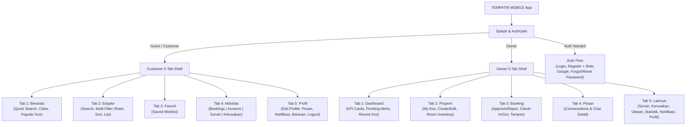

# TEMPATIN MOBILE — Phase 3 Mobile UI/UX Design Specification

> **Design Direction**: Hybrid Native Mobile — preserves TEMPATIN's *Warm Paper Notebook* aesthetic (`#0075DE`, `#F6F5F4`, `#FFFFFF`, `#000000`, `1px` hairline borders, `Inter` + `Source Serif 4`) while redesigning every flow for thumb-first Android/iOS ergonomics.
> **Scope**: **Customer** and **Property Owner** roles (Superadmin remains web-first).
> **Locked Business Flow**: **Owner Approval First** (`pending` → `approved` → Midtrans payment → `confirmed` → `active` → `completed`).

---

## 1. Information Architecture (IA)



---

## 2. Core User Journeys

### 2.1 Customer End-to-End Booking Journey (**Owner Approval First**)
```mermaid
sequenceDiagram
    actor C as Customer
    participant App as TEMPATIN Mobile
    participant API as Laravel /api/v1
    actor O as Property Owner
    participant MT as Midtrans Snap

    C->>App: Search & open Kos Detail (/kos/{slug})
    C->>App: Tap "Ajukan Sewa" -> BookingFormScreen
    App->>API: POST /api/v1/bookings (start_date, duration, optional room_id)
    API-->>App: Booking created (status: pending) + Invoice (unpaid)
    App-->>C: BookingDetailScreen ("Menunggu Persetujuan Pemilik")
    Note over C,O: Customer cannot pay yet; may cancel while pending
    O->>API: POST /api/v1/owner/bookings/{code}/approve (optional room_id)
    API-->>C: Notification ("Booking Disetujui! Silakan bayar")
    C->>App: Open BookingDetailScreen -> Tap "Bayar Sekarang"
    App->>API: POST /api/v1/bookings/{code}/pay (only if status == approved)
    API-->>App: snap_token + snap_redirect_url
    App->>MT: Open MidtransWebViewScreen
    MT-->>API: Webhook POST /payment/midtrans/notification (SHA-512 verified)
    App->>API: GET /api/v1/payments/{code}/sync (idempotent verification)
    API-->>App: booking: confirmed, invoice: paid
    App-->>C: PaymentResultScreen -> Download Nota PDF & Sign Digital Contract
```

### 2.2 Property Owner Daily Operations Journey
1. **Morning Overview (`OwnerDashboardScreen`)**: View 4 compact KPI tiles (`Total Kos`, `Aktif`, `Pending Booking`, `Laporan Terbuka`) + quick-action pills.
2. **Approve Booking (`OwnerBookingsScreen` → `OwnerBookingDetailScreen`)**: Review tenant details & dates → select an available room from `Room` inventory → tap **Setujui** (`pending` → `approved`) or **Tolak** (requires `rejection_reason`).
3. **Check-In & Check-Out**: Once Midtrans confirms payment (`confirmed`), tap **Konfirmasi Check-In** (`active`, room becomes `occupied`). At lease end, tap **Check-Out** (`completed`, room returns to `available`).
4. **Property & Room Maintenance**: Manage kos photos/facilities/map pin, toggle individual rooms (`available`/`occupied`/`maintenance`), confirm physical surveys, resolve maintenance tickets with `owner_notes`, reply to verified reviews, and review 6-month revenue charts.

---

## 3. Navigation & Interaction Standards

- **Bottom Navigation Bar**: Pure white (`#FFFFFF`), `1px` top hairline border (`rgba(0,0,0,0.08)`), height `64dp`, active icon/label `#0075DE`, inactive `#757575`, max 5 tabs with crisp `lucide` icons (`22dp`) and `11–12sp` labels.
- **Persistent Top AppBar (Customer Home/Activity)**: Compact `logo.png` (or screen title) on left; **Pesan** (chat) and **Notifikasi** (bell) icon buttons with Coral (`#F64932`) unread dot/count badges on right.
- **Sticky Bottom Action Bar**: Used on `KosDetailScreen` (Price/month on left + Ghost `Survei` / Primary `Ajukan Sewa` on right), `BookingFormScreen` (Total + `Kirim Pengajuan`), and `ContractDetailScreen` (Checkbox + `Tanda Tangani Kontrak`).
- **Bottom Sheets (instead of desktop modals/sidebars)**:
  - `FilterBottomSheet`: Type chips (`Putra`, `Putri`, `Campur`, `Eksklusif`), City selector, Min/Max Price inputs, Facility multi-select chips, Sort radio list, sticky `Reset` + `Terapkan`.
  - `ScheduleSurveyBottomSheet`: Date picker (`>= today`), time slot chips (`09:00`, `11:00`, `14:00`, `16:00`, custom), notes.
  - `WriteReviewBottomSheet`: Interactive 5-star picker + comment box (min 5 chars).
  - `RoomFormBottomSheet` / `RejectReasonBottomSheet` / `MaintenanceStatusBottomSheet` for Owner actions.

---

## 4. Screen Wireframe Specifications (Priority Screens)

### 4.1 Splash & AuthGate (`/`)
- Warm canvas `#F6F5F4`, centered `logo.png`, subtle progress indicator while reading Sanctum token from `FlutterSecureStorage` and validating `GET /api/v1/auth/me`.
- Routes directly to Customer Shell (Guest or Customer) or Owner Shell (Owner).

### 4.2 Login & Register (`/login`, `/register`)
- Clean single-column layout on `#F6F5F4` with white `TempatinCard` (`12dp` radius, `1px` hairline border).
- Role selector on Register: 2 segmented cards (`Pencari Kos / Customer` vs `Pemilik Kos / Owner`).
- Single `#0075DE` primary CTA (`Masuk` / `Daftar`), outlined `Lanjutkan dengan Google` button with Google mark, and subtle text link for `Lupa Password?`.

### 4.3 Customer Home (`HomeScreen`)
1. **Top Header**: Greeting + `logo.png` + Chat & Notification icon buttons.
2. **Search Trigger Bar**: White rounded card (`12dp`, hairline border) mimicking Notion's clean input: *"Cari kos berdasarkan kota, nama, atau kampus..."* (tapping focuses `ExploreScreen`).
3. **Quick City Chips**: Horizontal scroll pills (`Semua`, `Surabaya`, `Malang`, `Yogyakarta`, `Bandung`, `Jakarta Selatan`, `Semarang`).
4. **Kos Type Strip**: 4 compact pill chips (`Putri`, `Putra`, `Campur`, `Eksklusif`).
5. **Kos Populer / Terbaru**: Vertical list of high-clarity `KosCard`s with 16:10 photo, type pill, heart favorite toggle, city, star rating, and bold `Rp 850.000 / bln`.

### 4.4 Explore & Search (`ExploreScreen`)
- Pinned search bar + horizontal active-filter chips row + `Filter` button with active count badge.
- Pull-to-refresh + infinite-scroll paginated list of `KosCard`s (skeleton shimmer while loading, clean empty state with `Reset Filter` CTA when 0 results).

### 4.5 Kos Detail (`KosDetailScreen`)
- Full-bleed swipeable photo gallery (`PageView` + `1/5` counter badge + fullscreen zoom on tap) with floating back, share, and favorite heart buttons.
- White content cards stacked on `#F6F5F4` canvas:
  1. **Overview Card**: Type pill, verified badge, Title (`22sp` bold), address & city, rating summary.
  2. **Spec Strip**: Compact horizontal chips (`Luas`, `Kamar`, `Kamar Mandi`, `Parkir`, `Kamar Tersedia`).
  3. **Fasilitas Card**: Wrap grid of `FacilityChip`s (Lucide icon mapped by `facility.slug` + label).
  4. **Deskripsi Card**: Expandable warm graphite body text (`#615D59`).
  5. **Lokasi & Peta Card**: Embedded `flutter_map` (OSM tiles, `200dp` height) + `Buka di Google Maps` ghost button.
  6. **Pemilik Kos Card**: Owner avatar, name, and `Chat Pemilik` ghost CTA.
  7. **Ulasan Penghuni Card**: Star breakdown + verified review cards (with Owner reply block) + `Tulis Ulasan` CTA (visible only if `can_review == true`).
  8. **Kos Serupa**: Horizontal carousel of 3 similar kos.
- **Sticky Bottom Bar**: Monthly price + `Survei` (Ghost `#E6F3FE`) + `Ajukan Sewa` (Primary `#0075DE`).

### 4.6 Customer Activity Hub (`MyActivityScreen`)
- Top segmented tab bar (`Booking`, `Invoice`, `Survei`, `Kerusakan`) keeping all tenant lifecycle tools 1 tap away without cluttering the bottom nav.
- Each card shows entity code (`BKG-`, `INV-`), kos thumbnail/title, dates, price, semantic `StatusBadge`, and direct contextual action (e.g., `Bayar Sekarang` ONLY when `booking.status == 'approved'`, `Lihat Kontrak` when `confirmed`/`active`, `Unduh Nota PDF` when `invoice.status == 'paid'`).

### 4.7 Owner Dashboard (`OwnerDashboardScreen`)
- Greeting header + `Tambah Kos` compact primary button.
- **2x2 KPI Grid** (White hairline cards): `Total Properti`, `Kos Aktif`, `Booking Menunggu`, `Rata-rata Harga`.
- **Action Alerts Strip**: Compact clickable rows when `pending_bookings_count > 0`, `pending_surveys_count > 0`, or `open_maintenance_count > 0`.
- **Properti Terbaru**: Compact owner kos cards with status pill (`Aktif`/`Nonaktif`), price, and quick `Kelola Kamar` / `Edit` buttons.

---

## 5. Required Visual States (Mandatory on Every Screen)

Every screen in TEMPATIN MOBILE must explicitly handle 4 states:
1. **Loading**: Warm-gray shimmer skeleton (`#ECEAE7` → `#F6F5F4`) matching the exact target layout (avoid generic centered spinners on full lists).
2. **Empty**: Centered Lucide icon inside a soft `#FFFFFF` hairline circle, clear Bahasa Indonesia title + 1-line helper copy, and an optional primary CTA.
3. **Error**: Human-readable Indonesian error message mapped from `AppException` (e.g., network offline, server error, session expired) + `Coba Lagi` button.
4. **Success / Feedback**: Clean floating snackbar (`#191919` dark surface with white text, or semantic tint banner) and optimistic visual transitions (200ms ease).
