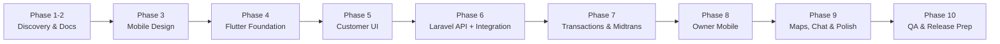

# TEMPATIN MOBILE — Phased Development Roadmap

> Strictly aligned with Phases 1–10 of the Master Project Directive. No full coding begins until Phase 1–2 documentation is approved.

---

## Phase Overview

---

## Detailed Phase Breakdown

### Phase 1 — Project Discovery *(Completed)*
- Audited `C:\Users\Thinkpad\Downloads\TEMPATIN` (17 controllers, 15 models, 26 migrations, seeders, policies, services, CSS/Blade views, assets).
- Verified actual database schema vs. legacy documentation and cataloged 8 backend bugs/risks.

### Phase 2 — Documentation *(Completed — Awaiting Approval)*
- Created all 8 foundational documents in `docs/`:
  - `PROJECT_ANALYSIS.md`, `FEATURE_MAPPING.md`, `DATABASE_REFERENCE.md`, `DESIGN_SYSTEM.md`, `MOBILE_ARCHITECTURE.md`, `API_CONTRACT.md`, `MOBILE_ROADMAP.md`, `TECHNICAL_DECISIONS.md`.
- **Gate**: User reviews and approves architecture, API contract, and scope before Phase 3/4.

### Phase 3 — Mobile Design & Information Architecture *(Completed)*
- Finalize Customer & Owner user journey flows and screen wireframes/specifications.
- Confirm final bottom navigation tabs, filter bottom sheet layout, and payment/contract step flows.
- Verify asset exports (`logo.png`, `logo-symbol.png`, `city-skyline.svg`, Inter font files).

### Phase 4 — Flutter Foundation *(Completed)*
- **Prerequisite**: Flutter SDK & Android SDK installed and verified (`flutter doctor`).
- Initialize Flutter project in `C:\Users\Thinkpad\Downloads\TEMPATIN MOBILE` (`com.tempatin.mobile`).
- Configure Android (`minSdk 23+`, cleartext local dev network config, internet/camera/gallery permissions) & iOS (`Info.plist` usage descriptions, bundle ID).
- Implement `AppTheme`, `AppColors`, `AppTypography`, `AppRadii`, core reusable widgets (`TempatinButton`, `TempatinCard`, `StatusBadge`, `TempatinTextField`, states, skeletons).
- Configure `GoRouter` (role-aware shells), `Riverpod`, `Dio` + `AuthInterceptor`, `FlutterSecureStorage`, `SharedPreferences`, and `--dart-define` environment config.

### Phase 5 — Customer Mobile Core (Discovery & Account) *(Completed)*
- Implement Auth screens: Splash/AuthGate, Login, Register (with Customer/Owner role selector), Forgot/Reset Password.
- Implement Customer Shell: `HomeScreen`, `ExploreScreen` + `FilterBottomSheet`, `KosDetailScreen` + `PhotoGalleryViewer`, `FavoritesScreen`, `ProfileScreen`, `EditProfileScreen`, `NotificationsScreen`.
- Wire clean repository abstractions connected to live Laravel endpoints.

### Phase 6 — Laravel Backend API & Integration *(Completed on branch `feature/mobile-api` — uncommitted pending review)*
- In `C:\Users\Thinkpad\Downloads\TEMPATIN`, created branch `feature/mobile-api`.
- Installed Laravel Sanctum (`laravel/sanctum ^4.5`), added `HasApiTokens` to `User`, updated `EnsureUserHasRole` & `bootstrap/app.php` for JSON responses.
- Fixed critical backend bugs (`MidtransService` approved-state deadlock & `syncTransactionStatus`, room IDOR check, unpaid nota guard, contract status guard, SVG upload block).
- Implemented 14 `Api\V1` controllers & 13 `Resources\V1` with normalized absolute asset URLs + PHPUnit API feature tests (`261 passed`, `934 assertions`).

### Phase 7 — Transaction Features (Booking, Midtrans, Invoices & Contracts) *(Completed)*
- Implemented `BookingFormScreen` (with optional room selection & live cost breakdown), `BookingDetailScreen`, and pending booking cancellation.
- Implemented `PaymentSummaryScreen`, `MidtransWebViewScreen` (Snap checkout), and `PaymentResultScreen` (with server-side status sync).
- Implemented `MyActivityScreen` (Bookings, Invoices, Surveys, Maintenance tabs), `ContractDetailScreen` (read clauses + electronic consent signing), and authenticated PDF viewer/downloader (`PdfViewerScreen` via `printing`/`share_plus`).
- Implemented `ScheduleSurveyBottomSheet`, `CreateMaintenanceScreen` (with photo upload), and `WriteReviewBottomSheet` for verified tenants.

### Phase 8 — Owner Mobile Ecosystem *(Completed)*
- Implemented Owner 5-tab Shell: `OwnerDashboardScreen`, `OwnerKosListScreen`, `OwnerKosFormScreen` (multi-photo upload, facility picker, OSM coordinates), `OwnerRoomsScreen` (CRUD inventory).
- Implemented `OwnerBookingsScreen` & `OwnerBookingDetailScreen` (Approve with room assignment, Reject with reason, Check-In, Check-Out) + `OwnerTenantsScreen`.
- Implemented `OwnerSurveysScreen`, `OwnerMaintenanceScreen`, `OwnerReviewsScreen` (with reply sheet), and `OwnerAnalyticsScreen` (revenue & occupancy charts via `fl_chart`).

### Phase 9 — Advanced Features (Maps, Messaging & Enhancements) *(Completed)*
- Integrated `flutter_map` + OpenStreetMap tiles on `KosDetailScreen` (plus "Buka di Google Maps" launcher) and interactive pin picker + Nominatim search (`MapLocationPickerScreen`) on `OwnerKosFormScreen`.
- Implemented `ChatListScreen` and `ChatDetailScreen` (`after_id` incremental polling while screen active, start conversation from Kos Detail & Customer Profile).
- Implemented deep-link routing on `NotificationsScreen` across booking, survey, maintenance, contract, review, and chat notifications.

### Phase 10 — Quality Assurance & Release Readiness *(Completed — Hardware/Store Signing Notes Recorded)*
- Unit & widget tests (`21/21 passed` across `widget_test.dart`, `phase5_customer_test.dart`, `phase7_transaction_test.dart`, `phase8_9_owner_chat_test.dart`).
- Backend PHPUnit suite (`261 passed`, `934 assertions`) & live HTTP smoke verification.
- Verified `flutter analyze` (0 issues), Release APK (`63.0 MB`), and Release AAB (`60.9 MB`) builds.
- Physical Android E2E device test pending USB phone attachment (`adb devices`), Play Store release keystore pending setup, and iOS build verification pending macOS/Xcode.
