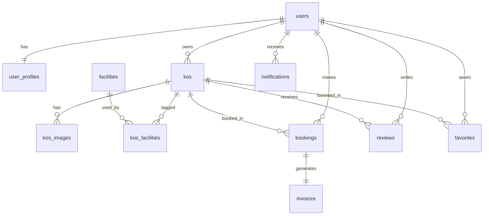

# Database Schema (Drift SQLite) — TEMPATIN OFFLINE

Database lokal disimpan pada file perangkat: `tempatin_offline.sqlite` (`schemaVersion = 1`) dengan **`PRAGMA foreign_keys = ON`**.

## 1. Entity Relationship Diagram

---

## 2. Daftar 11 Tabel SQLite

1. **`users`**: `id` (PK), `name`, `email` (UNIQUE), `password_hash`, `password_salt`, `role` (`member` | `owner`), `created_at`.
2. **`user_profiles`**: `id` (PK), `user_id` (UNIQUE FK -> `users.id`), `phone`, `address`, `bio`, `avatar_asset`, `updated_at`.
3. **`kos`**: `id` (PK), `owner_id` (FK -> `users.id`), `slug` (UNIQUE), `title`, `description`, `price`, `type`, `city`, `address`, `thumbnail_asset`, `status`, `area`, `rooms_count`, `bathrooms`, `garages`, `is_featured`, `created_at`, `updated_at`.
4. **`kos_images`**: `id` (PK), `kos_id` (FK -> `kos.id` CASCADE), `image_path`, `sort_order`.
5. **`facilities`**: `id` (PK), `name` (UNIQUE), `slug` (UNIQUE), `icon_key`.
6. **`kos_facilities`**: `kos_id` (FK), `facility_id` (FK) — Composite PK `(kos_id, facility_id)`.
7. **`bookings`**: `id` (PK), `booking_code` (UNIQUE), `kos_id` (FK), `member_id` (FK), `tenant_name`, `tenant_phone`, `tenant_email`, `start_date`, `end_date`, `duration_months`, `kos_price`, `subtotal`, `admin_fee`, `total_amount`, `notes`, `status`, `rejection_reason`, `created_at`.
8. **`invoices`**: `id` (PK), `invoice_number` (UNIQUE), `booking_id` (UNIQUE FK), `member_id` (FK), `kos_id` (FK), `amount`, `admin_fee`, `total_amount`, `due_date`, `paid_at`, `payment_method`, `status`, `created_at`.
9. **`reviews`**: `id` (PK), `kos_id` (FK), `member_id` (FK), `reviewer_name`, `rating`, `comment`, `owner_reply`, `created_at` — Unique `(kos_id, member_id)`.
10. **`notifications`**: `id` (PK), `user_id` (FK), `title`, `message`, `category`, `is_read`, `created_at`.
11. **`favorites`**: `member_id` (FK), `kos_id` (FK), `created_at` — Composite PK `(member_id, kos_id)`.

---

## 3. Strategi Seeding & Transaksi

- `DatabaseSeeder.seedIfEmpty()` mengecek `SELECT * FROM users LIMIT 1` terlebih dahulu di dalam `db.transaction`, sehingga aman dipanggil pada setiap startup tanpa menggandakan data.
- Proses booking (`BookingRepository.createBooking`) dan pembayaran demo (`BookingRepository.payDemoInvoice`) berjalan di dalam **SQLite Transaction** atomik agar status `bookings`, `invoices`, dan `notifications` selalu sinkron.
